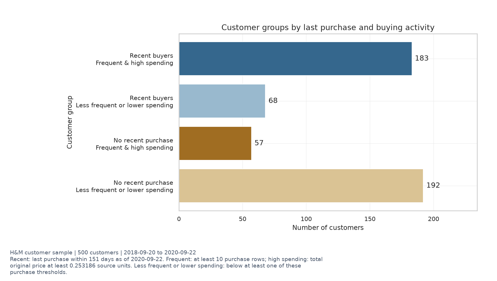

# 🟩 H&M 고객 구매·상품 이미지 분석  

## 🟢 프로젝트 소개  

고객 구매 기록과 상품 정보를 연결하고, NumPy 픽셀 연산·글 특성·그룹별 결측치 대치·IQR 이상치·통계·RFM 고객 분류를 한 흐름으로 구현한 학습 프로젝트다. 모든 분석 코드 줄에 쉬운 주석이 있고, 실행된 분석 노트북과 그래프 여섯 종류를 제공한다.  

기준은 [과제 요구사항](docs/requirement.md)이다. 필수 분석을 구현했으며, 선택 보너스인 고급 이미지 특성·코호트·Plotly는 포함하지 않았다.  

<br><br>

## 🟢 실행 방법  

데이터 준비가 끝난 프로젝트 최상위에서 실행한다. 처음 데이터가 없다면 _practice/01_데이터_준비_작업에서 Kaggle 접근·원본 두 CSV·고객 표본·선택 이미지 준비를 진행한다. 원본·표본·이미지는 저장소에 포함하지 않는다.  

```sh
uv sync --locked  
uv run --locked --python 3.11 main.py  
```

| 부분 | 풀네임 또는 뜻 | 하는 일 |  
| --- | --- | --- |
| uv | Python 도구 이름, 정식 약어 아님 | 프로젝트 환경 관리 |  
| sync | Synchronize | 잠금 파일에 맞춘 분석·노트북 개발 도구 설치 |  
| --locked | 잠금 파일 유지 | uv.lock의 해석 결과를 임의 갱신하지 않음 |  
| run | 실행 | 프로젝트 환경에서 프로그램 실행 |  
| --python 3.11 | Python 버전 지정 | Python 3.11 사용 |  
| main.py | 분석 시작 파일 | 전처리·통계·RFM·그래프·설명 생성 |  


새 프로젝트를 따로 초기화할 때만 uv init --python 3.11을 사용한다. init은 Initialize다. 현재 저장소에서는 다시 초기화하지 않는다. main.py는 입력을 보존하고 data/processed와 reports의 생성 결과를 다시 쓴다. 직접 수정한 출력이 있으면 먼저 별도로 보관한다.  

노트북 편집기는 다음 명령으로 연다.  

```sh
uv run --locked --python 3.11 jupyter lab notebooks/analysis_report.ipynb  
```

앞부분은 위 표와 같다. jupyter lab은 JupyterLab 편집기를 실행하고 마지막 경로는 열 노트북이다. 로컬 서버 주소에 붙은 인증 토큰은 공유하지 않는다. 종료는 실행한 터미널에서 Control+C다.  

<br><br>

## 🟢 파일의 역할  

| 위치 | 역할 |  
| --- | --- |
| [src/pipeline.py](src/pipeline.py) | DataAnalyzer 클래스와 필수 메서드 |  
| [src/charts.py](src/charts.py) | 제목·축·단위가 있는 여섯 종류 차트 |  
| [src/reporting.py](src/reporting.py) | 같은 집계에서 수치 설명과 제안 생성 |  
| [notebooks/analysis_report.ipynb](notebooks/analysis_report.ipynb) | 실제 실행한 표·그림·해석 |  
| [reports/analysis.md](reports/analysis.md) | 현재 실행의 자세한 집계 설명 |  
| data/processed | 고객별·상품별 처리 결과와 검사 집계, Git 제외 |  
| tests | 작은 정답 자료로 경로·전처리·RFM·픽셀 계산 검사 |  
| _practice/02_분석_시작 | 단계별 한국어 학습 문서, 현재 Git 제외 정책 유지 |  

라이브러리는 NumPy·Pandas·Matplotlib·Seaborn이다. 노트북 도구는 개발 그룹에 분리했다. 직접 Pillow·OpenCV·Scikit-learn 코드는 사용하지 않는다. Matplotlib JPEG 입력의 하위 의존성으로 Pillow가 설치될 수 있다.  

<br><br>

## 🟢 데이터 출처와 분석 단위  

[H&M Personalized Fashion Recommendations](https://www.kaggle.com/competitions/h-and-m-personalized-fashion-recommendations/data)의 구매 기록·상품 정보·연결 이미지를 사용한다. 이용은 [대회 규칙](https://www.kaggle.com/competitions/h-and-m-personalized-fashion-recommendations/rules)을 따르며 자유 재배포 라이선스로 간주하지 않는다.  

- 원본 articles.csv·transactions_train.csv에서 고정 SHA-256 순서로 고객 500명을 선택하고 해당 고객 전체 기간의 구매 이력을 보존했다.  
- 한 행은 구매 기록이며 동일한 행도 여러 번 구매일 수 있어 삭제하지 않았다.  
- order_date는 원본 t_dat, amount는 원본 price다. Frequency는 주문 수가 아닌 구매 행 수다.  
- Monetary는 원본 가격 합계다. 통화가 확인되지 않아 원화·매출·이익이라고 표시하지 않는다.  
- 설명 길이는 상품별 그룹 중앙값으로 대치하고 원래 비어 있던 값에 표시를 남긴다.  
- 가격은 IQR 이상치 표시와 비교용 경계 대치 사본을 만들며, RFM 금액은 원래 값을 사용한다.  
- 이미지 관계는 상품당 한 행으로 계산하고 사진 없는 거래를 전체 고객 분석에서 삭제하지 않는다.  

<br><br>

## 🟢 실제 기본 실행 결과  

| 항목 | 결과 |  
| --- | --- |
| 관측 기간 | 2018-09-20~2020-09-22 |  
| 고객·거래·상품 | 500명 / 11,927행 / 7,912개 |  
| 원본 거래·상품 연결 컬럼 | 29 |  
| 상품 설명 누락 | 33상품 / 47거래 행 |  
| IQR 범위 밖 | 512행, 삭제하지 않음 |  
| 실제 이미지 디코딩 | 100개 |  
| 사진 연결 구매 기록 | 156행 (1.31%) |  
| RFM 기준일 | 2020-09-22 |  

<br><br>

## 🟢 RFM 고객 그룹  

그룹 이름은 `/` 앞에서 최근 구매 여부, 뒤에서 구매 빈도·금액을 읽는다. `Recent buyers`는 최근 기준 안에 구매한 고객, `No recent purchase`는 그 기간 안에 구매가 없는 고객이다. `Frequent & high spending`은 빈도와 금액 기준을 모두 만족하고, `Less frequent or lower spending`은 둘 중 하나 이상이 기준보다 낮다는 뜻이다. 신규·실제 이탈 여부를 확정한 이름은 아니다.

최근 기준은 미구매 간격 151.0일 이하, 고가치는 구매 빈도 10.0행 이상과 금액 0.253186 이상을 모두 만족하는 것이다. 모두 표본 중앙값 기준이다. R·F·M 점수는 1~4의 평균 백분위 순위로 계산하고 같은 값에 같은 점수를 준다. 그룹은 아래 조건으로 별도 정의한다.  

| segment | customers | mean_recency | mean_frequency | mean_monetary | total_monetary | customer_share | monetary_share |  
| --- | --- | --- | --- | --- | --- | --- | --- |
| Recent buyers / Frequent & high spending | 183 | 46.7705 | 51.4863 | 1.4330 | 262.2428 | 0.3660 | 0.8018 |
| Recent buyers / Less frequent or lower spending | 68 | 65.8824 | 4.7500 | 0.1205 | 8.1942 | 0.1360 | 0.0251 |
| No recent purchase / Frequent & high spending | 57 | 342.4035 | 24.3333 | 0.6390 | 36.4233 | 0.1140 | 0.1114 |
| No recent purchase / Less frequent or lower spending | 192 | 454.3385 | 4.1406 | 0.1052 | 20.2041 | 0.3840 | 0.0618 |

  

<br><br>

## 🟢 비즈니스 인사이트 세 가지  

### 🟡 최근 고빈도·고금액 고객의 관계 유지  

- 근거: Recent buyers / Frequent & high spending 183명은 고객의 36.6%, 표본 구매 금액 합계의 80.2%다.
- 실행: 이 그룹에 구매 상품군과 연관된 추천을 소규모 대조 실험으로 제공한다. 목표는 재구매 유지이며 개선율은 아직 측정하지 않았다.  
- 검증: 통제군과 비교한 재구매율·순이익, 반품·할인·동의 정보를 추가로 확인해야 한다. 높은 금액만으로 추천의 효과가 입증되지는 않는다.  

### 🟡 상대적으로 오래 미구매한 고가치 고객의 재방문 검증  

- 근거: No recent purchase / Frequent & high spending 57명의 평균 미구매 간격은 342.4일이고 표본 금액 비중은 11.1%다.
- 실행: 이 그룹을 대상으로 재방문 안내와 미제공 대조군을 비교하는 실험을 설계한다. 목표는 재방문율 개선이며 실제 개선율은 아직 측정하지 않았다. 과거 구매일 기준 분류이며 현재 실제 이탈 고객이라고 단정하지 않는다.  
- 검증: 관측 종료 뒤 구매 기록과 수신 동의, 재방문 이유가 필요하다. 관측 기간 종료 때문에 재방문을 못 본 것일 수도 있다.  

### 🟡 그 외 최근 구매 고객의 후속 구매 기회  

- 근거: Recent buyers / Less frequent or lower spending 68명의 평균 구매 빈도는 4.75행, 평균 금액 합계는 0.1205 원본 가격 단위다.
- 실행: 이 그룹에 상품 사용 정보와 관련 상품 추천을 제공하는 실험을 설계하고 다음 구매일까지의 기간을 비교한다. 목표는 후속 구매까지의 기간 단축이며 실제 효과는 아직 측정하지 않았다. 신규 회원이라는 근거가 없으므로 신규 고객이라고 부르지 않는다.  
- 검증: 가입일·반품·배송 만족도와 후속 구매 관측 기간이 필요하다. 단순한 계절 구매 고객이라면 추천 효과가 없을 수 있다.  


<br><br>

## 🟢 그래프와 해석  

[분석 보고서](reports/analysis.md)의 요약 통계는 `feature` 열에 변수 이름을 표시한다. 구매가격·상품명 길이·설명 길이·사진 색상 평균·사진 안 색상 퍼짐 각각의 평균·중앙값·표준편차·Q1·Q3와 해석을 함께 확인할 수 있다. 거래 행 기준 통계와 상품 단위 상관분석은 구분한다.  

같은 보고서의 `결측치와 이상치 처리`에는 전체 평균 대신 상품군 중앙값을 선택한 이유와 대치의 한계, IQR로 찾은 구매를 비교용 사본에서만 조정하고 원래 고객 금액을 보존하는 이유를 적었다.  

[노트북](notebooks/analysis_report.ipynb)에 여섯 그림과 각각의 수치·해석을 저장했다. [자세한 집계 설명](reports/analysis.md)에는 요약 통계와 세 쌍 상관관계의 실제 상품 수가 있다. 가격·이미지 관계는 사진 있는 상품 100개로 제한된다.  

| 차트 | 결과 파일 |  
| --- | --- |
| 히스토그램 | [가격 분포](reports/figures/01_price_histogram.png) |  
| 박스플롯 | [IQR 전후 비교](reports/figures/02_price_boxplot.png) |  
| 막대그래프 | [고객 그룹 수](reports/figures/03_segment_bar.png) |  
| 히트맵 | [상품 특성 관계](reports/figures/04_correlation_heatmap.png) |  
| 산점도 | [이미지 밝기·구매 가격](reports/figures/05_image_price_scatter.png) |  
| 라인차트 | [월별 표본 금액](reports/figures/06_monthly_line.png) |  

첫 달과 마지막 달은 부분 관측 기간이다. 월별 차이를 전체 회사의 성장이나 계절성으로 단정하지 않는다. 이미지 배경과 촬영 방식도 밝기에 영향을 줄 수 있다. 상관관계는 원인이나 실제 마케팅 개선율을 증명하지 않는다.  

<br><br>

## 🟢 검증과 재현  

```sh
uv run --locked --python 3.11 -m unittest discover -s tests -v  
```

uv run·--locked·--python의 뜻은 실행 표와 같다. -m은 Module로 모듈 실행, unittest는 Unit Test로 기본 테스트 도구, discover는 검사 파일 찾기, -s는 Start directory로 검색 시작 위치, -v는 Verbose로 자세한 결과 표시다.  

현재 19개 회귀 검사는 상품 중복 연결·구매 기록 보존·상품 단위 대치·IQR·픽셀 평균·RFM·다운로드 저장 경로를 확인한다. 실제 표본에서도 거래 수·고객 금액 합계·네 그룹 합계·이미지 100개를 확인했고, 노트북을 새 커널에서 전체 실행했다. 그래프 파일 여섯 개의 라벨·단위·그림도 확인했다.  

입력 표본의 SHA-256 비교값과 분석 기준은 data/processed/analysis_summary.json에 저장된다. 실행 결과의 과거 관측 기간과 표본 선택 방법을 유지하고 같은 uv.lock으로 환경을 재현한다. README 수치는 이 기본 실행의 기록이다. 입력이나 옵션을 바꿨다면 새 reports/analysis.md·노트북을 확인하고 README의 요약도 갱신한다. main.py는 README를 자동 덮어쓰지 않는다.  

<br><br>

## 🟢 보안과 한계  

고객별 구매·RFM 결과는 Git 제외 data/processed에만 둔다. 원본·표본·인증 정보는 공개하지 않는다. 노트북 출력은 구조·상품 미리보기·집계·차트로 제한한다. 이미지가 있는 일부 상품과 고객 500명으로 전체 H&M 모집단을 대표한다고 주장하지 않는다.  

과거 관측 기간 이후의 구매, 확인된 통화·주문 번호·수량·반품·이익·가입일이 없으므로 현재 이탈·실제 주문 수·순이익·신규 가입을 계산했다고 말할 수 없다. 실제 캠페인·추천 모델·효과 검증은 실행하지 않았다.  

<br><br>

## 🟢 학습 문서와 선택 컨테이너  

분석 학습은 _practice/02_분석_시작/20_노트북_실행과_Python_첫걸음.md에서 시작한다. 단계별 문서는 현재 Git 제외 대상이므로 로컬 학습 자료다. 각 코드 줄과 터미널 명령의 뜻을 문서에서 풀이한다.  

Dockerfile·compose.yaml도 제공한다. 먼저 공식 Python 이미지를 직접 받아 수동 컨테이너에서 실행하는 선택 실습을 하고, 마지막에 Dockerfile·Compose를 사용한다. 자세한 순서는 분석 폴더 46번이다. 이번 환경에서는 Docker 엔진이 꺼져 있어 Compose 설정 검사만 통과했고 실제 이미지 빌드·컨테이너 실행은 검증하지 않았다. 필수 Python 분석의 실행 성공과 구분한다.  

<br><br>

## 🟢 용어  

| 약어 | 풀네임 | 의미 |  
| --- | --- | --- |
| RFM | Recency, Frequency, Monetary | 최근 구매·구매 빈도·구매 금액 |  
| IQR | Interquartile Range | 가운데 50% 구간 폭 |  
| OOP | Object-Oriented Programming | 객체 지향 프로그래밍 |  
| EDA | Exploratory Data Analysis | 탐색적 데이터 분석 |  
| RGB | Red, Green, Blue | 세 색상 채널 |  
| CSV | Comma-Separated Values | 쉼표 구분 표 |  
| JSON | JavaScript Object Notation | 이름·값 텍스트 구조 |  
| SHA | Secure Hash Algorithm | 파일 비교값 계산 |  
| PNG | Portable Network Graphics | 그래프 저장 그림 형식 |  
